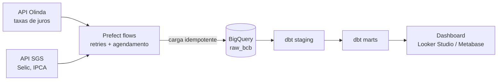

# Radar de Crédito BCB

> **Quanto cada banco cobra de juros — e como isso se move com a Selic?**

Pipeline de dados abertos do Banco Central do Brasil: extrai as taxas de juros praticadas por
instituição e modalidade e os indicadores macro (Selic e IPCA), orquestra a ingestão com
**Prefect**, carrega no **BigQuery**, modela com **dbt** e entrega tabelas prontas para um
dashboard.


> 🚧 **Status:** MVP em construção. Extração, carga, modelos dbt, testes e CI prontos.
> Próximos passos: deploy no Cloud Run e dashboard público (veja o [roadmap](#roadmap)).

## Arquitetura



| Camada | O que faz | Onde |
|---|---|---|
| Extração | Cliente das APIs Olinda (paginado) e SGS (em janelas de 5 anos), com retry | [`src/radar_bcb/extract`](src/radar_bcb/extract) |
| Carga | Tabelas particionadas por mês e clusterizadas; recarga por intervalo de datas | [`src/radar_bcb/load`](src/radar_bcb/load) |
| Orquestração | Flows e tasks Prefect com retries escalonados e agendamento diário | [`flows/pipeline.py`](flows/pipeline.py) |
| Transformação | Staging → marts, 18 testes de dados, freshness da fonte | [`dbt/`](dbt) |
| Qualidade | Ruff, pytest e `dbt parse` em todo push/PR | [`.github/workflows`](.github/workflows) |

## Os dados

**Taxas de juros por instituição** — [API Olinda](https://dadosabertos.bcb.gov.br/dataset/taxas-de-juros-de-operacoes-de-credito)
Taxa média (% a.m. e % a.a.) de cada banco em cada modalidade de crédito (cheque especial,
consignado, financiamento de veículos…), para PF e PJ. Cada período é uma janela móvel de
5 dias úteis e um novo começa a cada dia útil — cerca de **780 linhas por dia** em
**21 modalidades**.

**Séries do SGS** — [API SGS](https://dadosabertos.bcb.gov.br/dataset/sgs)

| Código | Série |
|---|---|
| 432 | Meta Selic definida pelo Copom (% a.a.) |
| 433 | IPCA — variação mensal (%) |

Para incluir uma série, basta adicioná-la ao dicionário `SERIES` em
[`sgs.py`](src/radar_bcb/extract/sgs.py).

## Modelos dbt

| Modelo | Grão | Para que serve |
|---|---|---|
| `stg_bcb__taxas_juros` | instituição × modalidade × período | Tipos e nomes padronizados (PF/PJ) |
| `stg_bcb__sgs_series` | série × data | Séries em formato longo |
| `dim_instituicao` | instituição (raiz do CNPJ) | Nome mais recente, primeira/última publicação |
| `fct_taxas_juros` | instituição × modalidade × período | Taxa, Selic vigente, **spread sobre a Selic**, mediana da modalidade |
| `rpt_ranking_taxas_atual` | instituição × modalidade (período atual) | **Quem cobra menos e quem cobra mais hoje** |
| `fct_indicadores_mensais` | mês | Selic média, IPCA 12 meses, **juro real ex-post**, medianas PF/PJ |

## Decisões técnicas

- **Carga idempotente.** Cada execução apaga o intervalo de datas que vai recarregar e insere
  os dados novos. Rodar o mesmo período duas vezes não duplica nada, e reprocessar é seguro.
  O DELETE usa parâmetros de query, nunca valores concatenados.
- **Janela de reprocessamento.** O flow recarrega as últimas 3 semanas a cada dia, porque o BCB
  pode revisar períodos recentes.
- **Particionamento mensal + clustering** por segmento/modalidade: as consultas do dashboard
  filtram por período e modalidade, então leem só o necessário.
- **Grão validado com dados reais.** A combinação `inicio_periodo + segmento + modalidade + cnpj8`
  é única — e é testada no dbt na própria fonte.
- **Detalhe da API Olinda:** ela rejeita espaços codificados como `+` no `$filter`; o cliente
  monta a URL com `%20` (há um teste para isso).
- **Custo.** O volume (~200 mil linhas/ano) cabe com folga na camada gratuita do BigQuery.

## Como rodar

Pré-requisitos: Python 3.11+ e um projeto GCP com BigQuery habilitado.

```bash
git clone https://github.com/MatheusPerpetua/radar-credito-bcb.git
cd radar-credito-bcb
python -m venv .venv && source .venv/bin/activate   # Windows: .venv\Scripts\activate
pip install -e ".[dev,dbt]"

cp .env.example .env          # preencha GCP_PROJECT
gcloud auth application-default login
```

```bash
python -m flows.pipeline              # extrai, carrega e roda o dbt build uma vez
python -m flows.pipeline --dias 90    # reprocessa 90 dias de taxas
python -m flows.pipeline --serve      # agenda diariamente (7h, horário de Brasília)
pytest                                # testes
```

Para rodar só o dbt: `cd dbt && dbt deps && dbt build --profiles-dir .`

## Estrutura

```
radar-credito-bcb/
├── src/radar_bcb/
│   ├── extract/       # clientes das APIs Olinda e SGS
│   ├── load/          # carga idempotente no BigQuery
│   └── config.py
├── flows/pipeline.py  # flows Prefect
├── dbt/               # staging, marts, testes e macros
├── tests/             # pytest (sem acesso à rede nem ao GCP)
├── Dockerfile         # imagem para Cloud Run Job
└── .github/workflows/ # CI
```

## Roadmap

- [x] Extração Olinda e SGS com paginação e retry
- [x] Carga idempotente no BigQuery
- [x] Flows Prefect com retries e agendamento
- [x] Modelos dbt com testes e freshness
- [x] CI: lint, testes e `dbt parse`
- [ ] Deploy como Cloud Run Job + Cloud Scheduler, com conta de serviço dedicada
- [ ] Alertas de falha (Prefect Automations)
- [ ] Dashboard público com ranking de taxas e spread vs. Selic
- [ ] Mais séries: inadimplência e saldo da carteira de crédito
- [ ] Agente de IA que responde perguntas sobre os marts

## Licença

[MIT](LICENSE). Dados: Banco Central do Brasil, sob a política de dados abertos do BCB.
